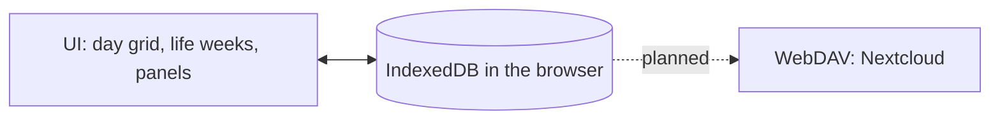

# Architecture

Developer notes for ichido. User-facing readme lives in [README.md](README.md).

## Architecture

One static page, no server. The UI reads and writes one IndexedDB record per day; a later WebDAV sync will just copy those records to Nextcloud and back.



Code map:

| Area | Files |
|------|-------|
| Day grid, gestures, running clock | `src/dayview.ts` |
| Life in weeks | `src/lifeview.ts` |
| Reasons, events, settings state | `src/state.ts` |
| IndexedDB access and migration | `src/db.ts` |
| Undo/redo stacks | `src/history.ts` |
| Picker, tooltip, inline editing | `src/picker.ts`, `src/tooltip.ts`, `src/inlineedit.ts` |
| Panels | `src/reasonspanel.ts`, `src/eventspanel.ts`, `src/settingspanel.ts` |
| Wiring, types, styles | `src/main.ts`, `src/types.ts`, `src/style.css` |

## Interactions

- Click an empty box: done (green). Click a done box: pick one or more failure reasons plus an optional note, then Save. Click a failed box: change reasons, edit the note, or clear the block.
- Drag paints one stroke with the start box's status: starting on an empty or done box paints done; starting on a failed box copies its reasons. The eraser button clears on click or drag. Touch taps only, so page scrolling stays native.
- Undo/redo: one gesture is one step. History is session-only (cleared on refresh), Ctrl+Z / Ctrl+Shift+Z / Ctrl+Y also work.
- Reasons carry a severity of 1 to 5. A failed box is colored by its worst selected reason: yellow (mild) to dark red (severe). Reasons are editable and cannot be deleted while failed blocks reference them.
- The clock row slides along the day (HH:MM:SS, blinking colons, "time is running...") and hour labels darken as they pass. On today's view only.
- Life view: one box per week from your birthday (set it in Settings), current week highlighted in blue, weeks colored by life events (Events panel). Counts of failed blocks per reason live in the Reasons panel.

## Data model

IndexedDB database `ichido`, version 2:

| Store | Key | Contents |
|-------|-----|----------|
| `days` | `YYYY-MM-DD` (local time) | 48 cells `{ status, reasonIds[], note? }`, plus `updatedAt` |
| `reasons` | id | `topic`, `severity` (1-5) |
| `events` | id | `date`, `label`, `color` |
| `settings` | `app` | `birthdate`, `lifespanYears` |

- `updatedAt` exists for the planned WebDAV sync (last-write-wins per day).
- Days saved before multi-select reasons existed are migrated on read (`normalizeDay` in `src/db.ts`).
- There is no export yet: clearing browser data loses everything. Export/import is first on the roadmap below.

## Development

```sh
npm install
npm run dev      # dev server
npm run build    # type-checks (tsc) then bundles to dist/
npm run preview  # serve the build locally
```

TypeScript strict mode, vanilla DOM, no runtime dependencies. Vite is the only tooling.

Breakpoints: below 640px the day grid splits into two halves (hours 0-11, then 12-23) and the life grid into two 26-week rows per year; both switch via `matchMedia` and re-render on rotation.

## Deploy

Cloudflare Pages, project `ichido`, custom domain `ichido.leekaize.com`:

- Git integration: build command `npm run build`, output directory `dist`; every push to the production branch redeploys.
- Direct upload: `npm run build` then `npx wrangler pages deploy dist --project-name ichido`.

No server logic and no SPA redirects are needed; the built `dist/` is plain static files. Deploy updates never touch stored data; schema changes go through the IndexedDB version upgrade in `src/db.ts`.

## Roadmap

Shipped (this repo):

- Day view: 48 half-hour boxes, drag painting, eraser, undo/redo
- Failure reasons: severity colors, multi-select, notes, per-reason counts, inline editing
- Life in weeks with life events, birthday and lifespan settings
- Running clock and now indicator
- Mobile layouts, dark mode, reduced-motion support

Next:

- JSON export/import of all four stores
- Per-reason failure history: the list of failed blocks with their notes
- Week, month, and year views

Later:

- WebDAV (Nextcloud) sync, last-write-wins per day
- CalDAV: show planned events from a Nextcloud calendar
- PWA/service worker so the page itself loads offline
- Keyboard navigation for the grids
- Interpolated painting so very fast drags cannot skip boxes
- Optional: combine severity as a sum instead of max (`maxSeverity` in `src/state.ts`)
