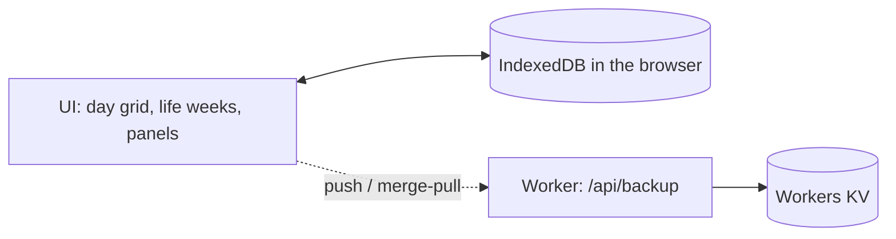

# Architecture

Developer notes for ichido. User-facing readme lives in [README.md](README.md).

## Architecture

One static page plus one small server route. The UI reads and writes one IndexedDB record per day; the optional sync pushes a whole-store backup JSON to a Workers KV namespace and merges the server copy back in per record.



Code map:

| Area | Files |
|------|-------|
| Day grid, gestures, running clock | `src/dayview.ts` |
| Life in weeks, birthday prompt | `src/lifeview.ts`, `src/birthdaymodal.ts` |
| Reasons, events, settings state | `src/state.ts` |
| IndexedDB access and migration | `src/db.ts` |
| Undo/redo stacks | `src/history.ts` |
| Picker, tooltip, inline editing | `src/picker.ts`, `src/tooltip.ts`, `src/inlineedit.ts` |
| Panels | `src/reasonspanel.ts`, `src/eventspanel.ts`, `src/settingspanel.ts` |
| Focus list | `src/focuslist.ts` |
| Habit tracker | `src/habittracker.ts` |
| Backup export/import | `src/backup.ts` |
| Sync client: auto push/pull, merge orchestration, token storage | `src/sync.ts` |
| Backup API route (runs on the Worker) | `routes/api/backup.ts` |
| Environment schema (sync token) | `env.ts` |
| Wiring, types, styles | `src/main.ts`, `src/types.ts`, `src/style.css` |

## Interactions

- Click an empty box: done (green). Click a done box: pick one or more failure reasons plus an optional note, then Save. Click a failed box: change reasons, edit the note, or clear the block.
- Drag paints one stroke with the start box's status: starting on an empty or done box paints done; starting on a failed box copies its reasons. The eraser button clears on click or drag. Touch taps only, so page scrolling stays native.
- Undo/redo: one gesture is one step. History is session-only (cleared on refresh), Ctrl+Z / Ctrl+Shift+Z / Ctrl+Y also work.
- Reasons carry a severity of 1 to 5. A failed box is colored by its worst selected reason: yellow (mild) to dark red (severe). Reasons are editable and cannot be deleted while failed blocks reference them.
- The clock row slides along the day (HH:MM:SS, blinking colons, "time is running...") and hour labels darken as they pass. On today's view only.
- Life view: one box per week from your birthday (set it in Settings), current week highlighted in blue, weeks colored by life events (Events panel). It sits right of the focus list as a small static snapshot (no hover tooltips there); clicking it (or the expand button) opens the full grid below the focus list, collapse returns to the mini. Without a birthday the grid renders an example (born 1990-01-01, real events skipped); a dialog asks for the birthday, auto-opens once per page load, and reopens from the link in the view's summary. Counts of failed blocks per reason live in the Reasons panel.
- Focus: a to-do list left of the life view, under the day grid, always visible. Enter adds, circle toggles done, text click edits, x removes; "clear done" wipes completed items.
- Habits: clickable boxes under the focus list, always visible. Click marks the habit achieved today (box turns green), click again cancels. Text click renames, x deletes the habit and its history, Enter adds. Each box shows a strength bar: the share of achieved days over the last 30 days (only days since creation count), weighted with a 10-day half-life so recent days matter more; the bar runs red (weak) to green (strong). The streak in days sits next to the bar; today not being achieved yet does not break a streak that runs through yesterday.
- Settings > Backup: Export downloads all six stores as one JSON file. Import asks for confirmation, then replaces the stores with the file's contents and refreshes the UI.
- Settings > Sync: paste the sync token once (kept in localStorage, never inside backups), then Push sends all stores to the server and Pull replaces this browser's stores with the server copy after confirmation. With a token set, auto-sync also runs by itself: local changes push two seconds after the last write (plus a best-effort keepalive flush when the tab closes, for payloads under 64KB), and the server copy merges in on page load, once a minute, when a hidden tab becomes visible again, and when the network comes back. The status line reports the last sync; Workers KV can lag up to ~60s behind another device's push, and the next pull catches up.

## Data model

IndexedDB database `ichido`, version 4:

| Store | Key | Contents |
|-------|-----|----------|
| `days` | `YYYY-MM-DD` (local time) | 48 cells `{ status, reasonIds[], note? }`, plus `updatedAt` |
| `reasons` | id | `topic`, `severity` (1-5) |
| `events` | id | `date`, `label`, `color` |
| `todos` | id | `text`, `done`, `createdAt`, `doneAt?` |
| `habits` | id | `name`, `days[]` (sorted YYYY-MM-DD achieved), `createdAt` |
| `tombstones` | `store` + `id` | `deletedAt`; marks deleted records so merges do not resurrect them |
| `settings` | `app` | `birthdate`, `lifespanYears` |

- Every mutable record carries `updatedAt` (epoch ms; days always had it, reasons, todos, habits, and settings gained it). The sync merge uses it for per-record last-write-wins: records are unioned by key, the newer stamp wins, ties keep the local copy. Deletions always win: a tombstone from `db.delete*` (`src/db.ts`) removes its record everywhere, so stale devices cannot bring a deleted todo, habit, event, or reason back. Merges run in `mergeBackup` (`src/backup.ts`); manual import and Pull still replace whole stores via `applyBackup`.
- Days saved before multi-select reasons existed are migrated on read (`normalizeDay` in `src/db.ts`).
- Backup: Export writes all six stores plus tombstones to a versioned JSON file (version 5). Import sanitizes the file (`sanitize*` in `src/backup.ts`), then clears and refills the stores in one transaction (`replaceAllStores` in `src/db.ts`); undo stacks are cleared and the UI re-reads from the database. Exports from before the focus list existed import with an empty `todos` store; exports from before the habit tracker existed import with an empty `habits` store; exports from before tombstones existed import keeping the local tombstones. Sync Push reuses the same payload builder (`buildPayload`); auto-sync Pull feeds the server copy through `mergeBackup` and pushes back when the merge changed anything, so all devices converge.

## Development

```sh
npm install
npm run dev      # dev server: client plus a local Worker running routes/
npm run build    # type-checks (tsc) then bundles via Void's vite plugin
```

TypeScript strict mode, vanilla DOM on the client, no runtime dependencies. Void is the only framework: it serves `routes/api/backup.ts` on a local Worker in dev and deploys the whole thing to Cloudflare Workers. Node 24 is pinned via Volta (the `volta` key in `package.json`).

`tsc` only checks `src/` (see `include` in `tsconfig.json`); `routes/` is exercised by the dev server and the build, not by `tsc`. The root tsconfig keeps `"files": []` so the generated `.void/*.d.ts` (server types, Cloudflare workers types) stay out of the DOM program: they clash with lib.dom on `append` and friends.

Breakpoints: below 640px the day grid splits into two halves (hours 0-11, then 12-23) and the life grid into two 26-week rows per year; both switch via `matchMedia` and re-render on rotation.

## Deploy

Cloudflare Worker managed by Void. Worker name `ichido` (`cloudflare.name` in `void.config.ts`), provisioned resources and account recorded in `void.lock.json`:

- Deploy: `npx void deploy`. Builds both bundles, reuses the provisioned KV binding, uploads a staged version, runs a readiness check, then switches traffic; a version that fails readiness never serves.
- Auth for the CLI: browser sign-in with `void cloudflare login` (needs an OS keyring; on this WSL install `libsecret-tools` + `gnome-keyring` first), or a `CLOUDFLARE_API_TOKEN` environment variable with Workers Scripts: Edit and Workers KV Storage: Edit. An env token takes precedence over a stored session.
- Production secrets: `void secret put SYNC_TOKEN=...` for the token declared in `env.ts`; deploy refuses to upload while a required server secret is missing remotely. Local `.env` values never deploy.
- Live: custom domain `ichido.leekaize.com`, also served at `https://ichido.leekaize.workers.dev`. Cloudflare Pages is no longer used; the old `deploy.sh` (wrangler pages deploy) is removed.

Deploys never touch stored data: IndexedDB stays in the browser, the sync backup stays in Workers KV. IndexedDB schema changes go through the version upgrade in `src/db.ts`.

## Roadmap

Shipped (this repo):

- Day view: 48 half-hour boxes, drag painting, eraser, undo/redo
- Focus list: always visible beside the life view, under the day grid, add/toggle/edit/delete, done items clearable in one click
- Habit tracker below the focus list: click to mark achieved today, strength bar over the last 30 days with a 10-day half-life, streak count
- Failure reasons: severity colors, multi-select, notes, per-reason counts, inline editing
- Life in weeks with life events, birthday and lifespan settings, example grid before a birthday is set, scaled-down mini beside the focus list that expands to the full grid
- Running clock and now indicator
- Mobile layouts, dark mode, reduced-motion support
- JSON export/import of all stores
- Server backup sync: Push/Pull to Workers KV behind a sync token, served by a Void Worker on Cloudflare
- Auto-sync between devices: debounced push on any data write, merge-on-pull with per-record last-write-wins, deletion tombstones, pull on load / every minute / on tab visible / on reconnect

Next:

- Per-reason failure history: the list of failed blocks with their notes
- Week, month, and year views

Later:

- CalDAV: show planned events from a Nextcloud calendar
- PWA/service worker so the page itself loads offline
- Keyboard navigation for the grids
- Interpolated painting so very fast drags cannot skip boxes
- Optional: combine severity as a sum instead of max (`maxSeverity` in `src/state.ts`)
